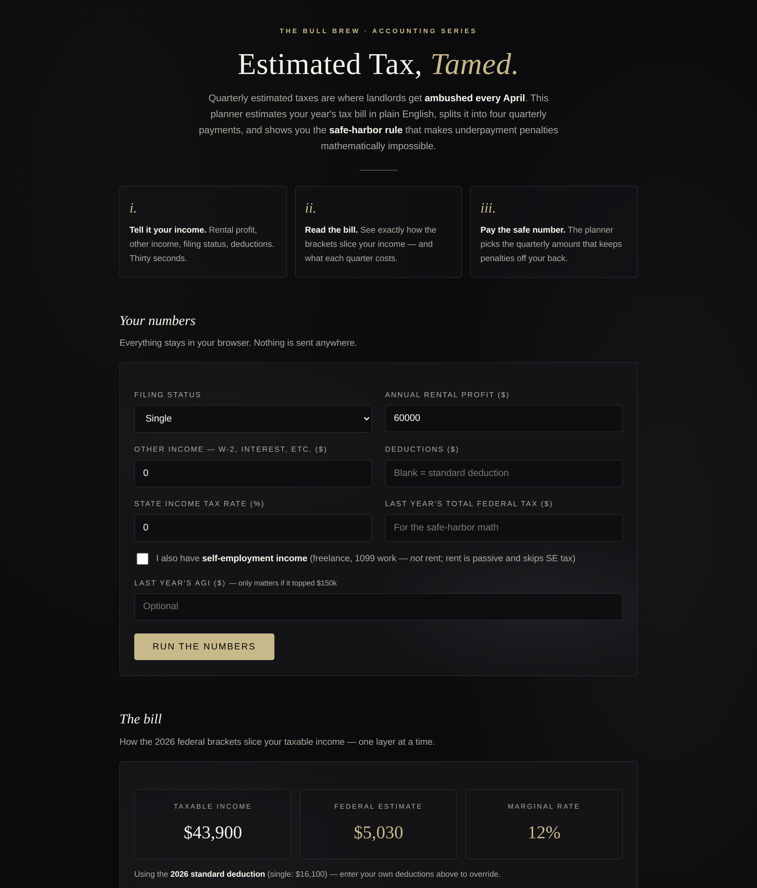

# Estimated Tax Planner — Quarterly Taxes, Tamed

**Live:** https://thebullbrew.github.io/estimated-tax-planner/

Quarterly estimated taxes are where landlords get ambushed every April. This planner estimates
your year's tax bill in plain English, splits it into four quarterly payments, and shows you the
**safe-harbor rule** that makes underpayment penalties mathematically impossible.

## What it does

- **The bill** — enter rental profit, other income, filing status, and deductions; see the 2026
  federal brackets slice your taxable income one layer at a time, with your marginal rate called out.
- **Self-employment tax** — optional 1099/freelance income modeled with the real SE formula
  (15.3% on net earnings up to the wage base, 2.9% Medicare above, 0.9% additional Medicare).
- **State tax** — simple flat-rate estimate on top of the federal math.
- **The safe harbor** — enter last year's total tax and the planner computes the penalty-proof
  quarterly (100% of last year, 110% if AGI topped $150k), then recommends whichever is higher:
  the estimate or the harbor — and tells you why.
- **The calendar** — the four 2026-tax-year due dates with mark-as-paid toggles that persist.
- **What-if** — drag a slider for extra income and watch the marginal dollar do its damage.
- **Saved scenarios** — name and keep plans to compare year over year.

Everything runs client-side in your browser. Nothing is sent anywhere.

## The method behind it

The IRS punishes underpayment, not honest estimation error — the safe harbor exists precisely so
you can pay a known, fixed number four times a year and owe zero penalty even if the year runs hot.
This tool turns that rule into a single quarterly number you can set and forget.

## Run it

No build step, no backend. Open `docs/index.html` in any browser, or install it as a PWA
(manifest + offline service worker included).

*Estimates only — not tax advice. Confirm the final numbers with a CPA before you file or pay.*
